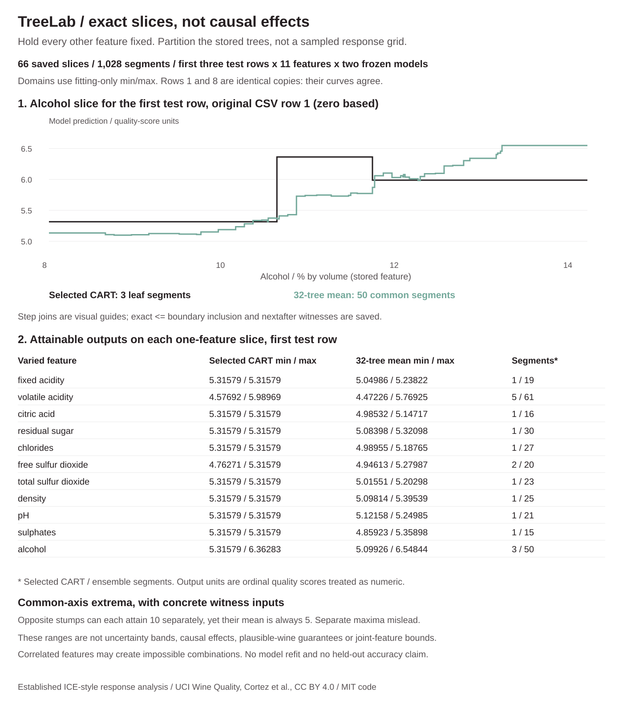
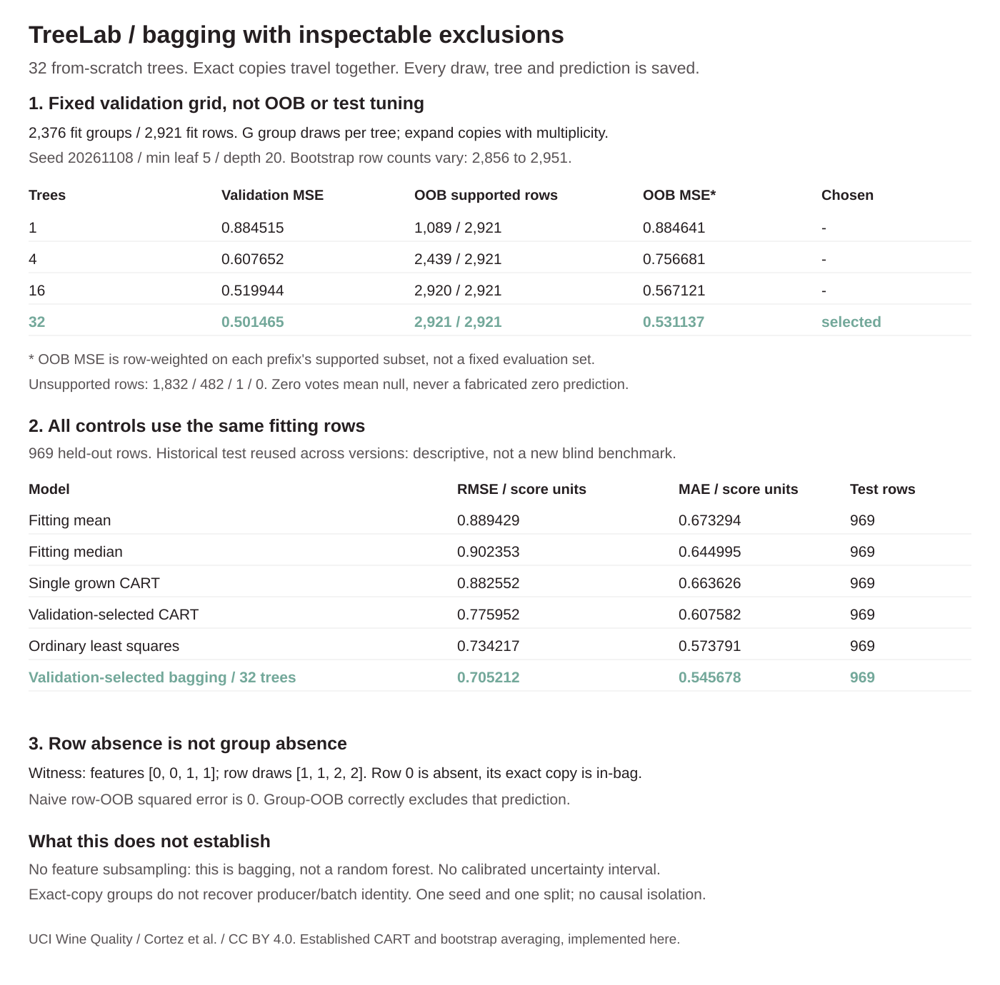
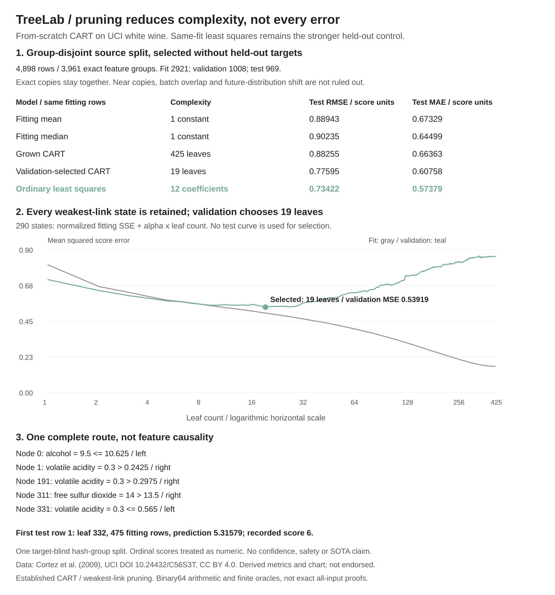

# TreeLab

A regression tree you can inspect from the first split to the final pruning.
CART and weakest-link cost-complexity pruning are implemented from scratch in
NumPy. No scikit-learn model, paid API, pretrained model or autograd engine.

**v0.3: exact one-feature response slices for frozen trees and ensembles.**
Intersect reachable leaf regions, combine all member boundaries, and return
attainable min/max outputs with concrete binary64 input witnesses. All other
features stay fixed. The fixed first-three-row demo saves **66 slices / 1,028
segments**, with member leaf IDs and outputs. These are model responses, not
causal effects, plausible-wine guarantees, uncertainty intervals or joint-feature
robustness bounds. No refit or new accuracy claim.



[Sweep method and boundaries](SWEEPS.md) · [Bagging and OOB](BAGGING.md) · [Pruning](METHOD.md)

<details>
<summary>v0.2 group-bootstrap audit, preserved unchanged</summary>



The fixed validation grid [1,4,16,32] selected 32 trees. Historical test RMSE
0.70521 versus same-fit least squares 0.73422. Reused test, not a new blind
benchmark, causal isolation or calibrated uncertainty. Exact copies travel
together; zero OOB votes mean null.

</details>

<details>
<summary>Original v0.1 pruning audit, preserved unchanged</summary>



The linear control beats the single selected and grown trees on this split.

</details>

## What runs

- All distinct adjacent-value splits are scored with centered prefix sums.
  Leaf predictions are fitting-row means. Split ties use feature index, then
  threshold; decisions use `<=` on the left. Rounded adjacent-float midpoints
  fall back to the lower value so the training partition stays valid.
- Weakest-link pruning keeps **290 states**, from **425 leaves** to one root.
  Every state's alpha, fitting MSE, validation MSE and removed node IDs is saved.
  Exact floating ties are pruned together; ancestors supersede tied descendants.
  Stable `math.fsum` node statistics avoid CPU-dependent dot-product reduction.
- Validation MSE alone selects **19 leaves**, alpha **0.00365165**. The selected
  model is not refit. All **969 test predictions** and six first-row routes are
  retained. The full grown and selected models are reusable JSON.
- **70 tests** include 40 independent all-threshold split references, exact
  Fraction enumeration of every subtree of 12 small fitted trees, simultaneous
  weakest-link and validation-tie controls, all saved test predictions, complete
  refit, test-target mutation, strict JSON, source hashes and figure data.
- Group-bootstrap bagging preserves all 32 trees, draws and member predictions.
  OOB excludes the entire feature group, shows each row's vote count and leaves
  unsupported predictions null. No feature subsampling or uncertainty claim.
- Exact one-axis slices retain <= boundary inclusion, nextafter witnesses,
  all member leaves and attainable extrema on the common ensemble partition.
  Correlated-feature combinations may be implausible; no causal claim.
- Thirteen CLI modes and a package with data, frozen models and report. CI checks
  Python 3.10-3.13 and installs the wheel outside the source checkout.

## Real data, not a random row split with exact-copy leakage

The unmodified [UCI Wine Quality dataset](https://archive.ics.uci.edu/dataset/186/wine%2Bquality)
white-wine CSV has **4,898 rows**, 11 physicochemical features and an ordinal
expert quality score. Its SHA-256 is
`76c3f809815c17c07212622f776311faeb31e87610d52c26d87d6e361b169836`.
The original names file is bundled too. This is not a price, safety, health or
causal outcome.

Parse feature values as binary64, serialize each feature's `float.hex()` value,
SHA-256 the feature vector, and sort the **3,961 unique feature groups**. The
first floor(60%) groups fit; the next through floor(80%) validate; the rest test.
This yields **2,921 / 1,008 / 969 rows**. Every exact feature copy stays in its
group, regardless of target. There are zero conflicting-target feature groups
in this source, and a synthetic conflict control checks grouping behavior.
The split uses no targets and is invariant to source row permutation.

Exact-copy exclusion is not proof of batch, producer, time or near-duplicate
independence. UCI supplies no batch IDs here. There is no official train/test
split, no repeated-split confidence interval and no future-distribution claim.
The fixed protocol is min leaf 5, max depth 20; no depth/seed/split search.
The held-out results did not choose these settings or the pruning state.

## Same-fit controls stay visible

| Model, all on the same 2,921 fitting rows | Test RMSE | Test MAE |
|---|---:|---:|
| Fitting mean | 0.88943 | 0.67329 |
| Fitting median | 0.90235 | 0.64499 |
| Grown CART, 425 leaves | 0.88255 | 0.66363 |
| Validation-selected CART, 19 leaves | 0.77595 | 0.60758 |
| Ordinary least squares, 12 coefficients | 0.73422 | 0.57379 |
| Validation-selected group bagging, 32 trees | **0.70521** | **0.54568** |

The linear control uses only fitting-row centering/scaling and an intercept.
No ridge parameter or test-tuned preprocessing. It is solved by NumPy's
least-squares routine, not a hand-implemented linear algebra solver. MSE
selection treats ordinal scores as numeric and is not a ranking metric.
Complexity units differ: 12 coefficients are not equivalent to 19 tree leaves.

## Run offline

```bash
python -m pip install -e .
python -m unittest discover -s tests -v
bash examples/demo.sh
python -m treelab demo
python -m treelab audit --output /tmp/treelab-refit
python -m treelab predict --model treelab/artifacts/selected-model.json --input examples/input.json
```

No runtime network calls. `demo` prints the frozen report; `audit` refits and
reproduces it. `predict` returns every branching decision as well as predictions.
Inputs must contain exactly `features`, a nonempty two-dimensional numeric
array of the saved width. NaN, infinity, booleans, duplicate JSON keys and
magnitudes above 1e100 are rejected.

For your own numeric data, `fit` accepts exactly `features` and `targets`.
It does not automatically invent a validation split or choose a model for you.
`prune` applies an explicit nonnegative normalized alpha to a saved grown tree.

```bash
python -m treelab fit --input examples/train.json --output /tmp/tree.json --min-leaf 1 --max-depth 5
python -m treelab prune --model /tmp/tree.json --alpha 1 --output /tmp/pruned.json
```

## Limits and attribution

Greedy split search is not globally optimal tree learning. Pruning optimizes
subtrees of the grown tree, not all possible partitions. Alpha has units of
score-squared per leaf because risk is SSE divided by the **root fitting-row
count**, not each leaf count. Binary64 arithmetic, exact floating tie rules
and finite reference tests are not all-input numerical certificates. A route
explains how this model computes one output, not feature causality or a
counterfactual effect. Out-of-range inputs get piecewise-constant extrapolation,
not evidence of accuracy. The learner does not support missing/categorical
values, user-supplied sample weights or a production monitoring service.

[Method, numerical semantics and sources](METHOD.md).
[Complete report](treelab/artifacts/report.json).
[Data license and source provenance](treelab/data/LICENSE.md).

Code is MIT. Data and derived chart/metrics: Cortez, P., Cerdeira, A., Almeida,
F., Matos, T. & Reis, J. (2009), UCI Wine Quality,
DOI [10.24432/C56S3T](https://doi.org/10.24432/C56S3T), CC BY 4.0.
Established CART, weakest-link pruning and least squares are not claimed
inventions. No author or UCI endorsement is implied.

## Group-bootstrap CLI

```bash
python -m treelab bag-demo > /tmp/bagging-saved.json
python -m treelab bag-audit --output /tmp/bagging-refit
python -m treelab bag-fit --input examples/train.json --output /tmp/ensemble.json --trees 4 --min-leaf 1
python -m treelab bag-oob --model /tmp/ensemble.json --input examples/train.json
```

`bag-predict --model MODEL --input INPUT [--trees PREFIX]` accepts only a
`features` array matching the fitting width. `bag-oob` requires the exact original
fitting features/targets and row order. See [BAGGING.md](BAGGING.md) for support
semantics, the duplicate failure witness and the preserved same-fit controls.

The complete frozen ensemble is bundled as deterministic `bagging-model.json.gz`
(gzip of the full JSON, zero timestamp). CLI model loading accepts `.json.gz`
as well as plain JSON. This changes storage only, not trees, draws or predictions.

## One-feature response CLI

```bash
python -m treelab sweep-demo > /tmp/saved-sweeps.json
python -m treelab sweep-audit --output /tmp/sweep-audit
python -m treelab sweep --model treelab/artifacts/bagging-model.json.gz --input examples/sweep.json
```

Sweep input contains exactly `row`, `feature`, `low`, `high`. Optional `--trees`
restricts an ensemble prefix. [SWEEPS.md](SWEEPS.md) covers finite-domain and
boundary semantics, witnesses, tests and interpretation limits.
